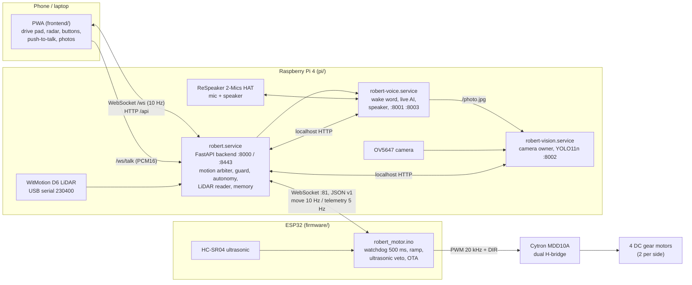
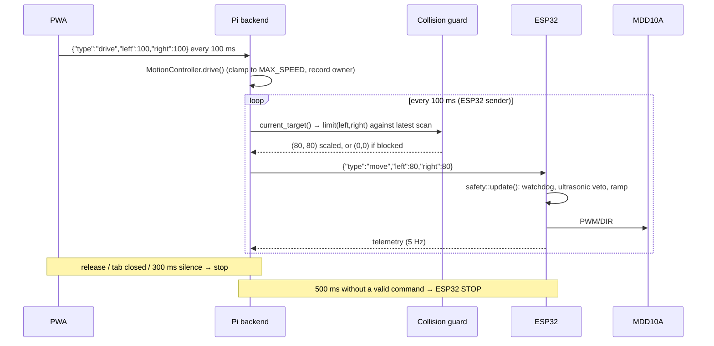
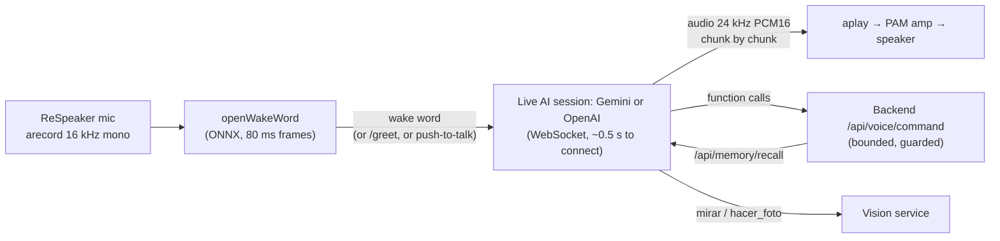

# Robert V2 — a four-wheeled rover that follows you, sees, talks and remembers

Robert V2 is a home-built differential-drive rover with a layered control architecture:
a real-time **ESP32 motor and safety controller**, a **Raspberry Pi** that runs perception,
navigation, voice and a web control panel, and a **progressive web app (PWA)** used as the
remote control from a phone. It can be driven by hand, explore a room on its own using a 2D
LiDAR, follow a person using the camera and the LiDAR together, hold a spoken conversation
through a live speech-to-speech AI (Gemini Live or OpenAI Realtime, your choice), take photos, greet strangers, and keep a memory of what it experiences
from one session to the next.

This document is the technical guide to the project: what is being built, why it is built
this way, what it depends on, how every subsystem works, and how to build, calibrate, test
and run it. The user-facing side of the robot (the PWA and Robert's speech) is in Spanish;
the code and this guide are in English.

- Predecessor: [Robert V1](https://github.com/FranciscooGarciaa/Robert) was built on a
  Freenove tank kit whose vendor server had no watchdog. V2 replaces that stack with its own
  hardware and software from the motor driver up. Project page: <https://franslab.es/projects/robert>.
- Status (2026-10-28): all subsystems below are implemented, tested in the house and taken
  out on the street. See [Project status](#project-status-and-known-limitations).

## Contents

1. [What we are building](#what-we-are-building)
2. [System architecture](#system-architecture)
3. [Hardware](#hardware)
4. [Safety design](#safety-design)
5. [ESP32 firmware](#esp32-firmware)
6. [Raspberry Pi backend](#raspberry-pi-backend)
7. [Perception](#perception)
8. [Navigation](#navigation)
9. [Voice](#voice)
10. [Memory](#memory)
11. [Web app (PWA)](#web-app-pwa)
12. [Dependencies](#dependencies)
13. [Build, setup and deployment](#build-setup-and-deployment)
14. [Calibration](#calibration)
15. [Testing](#testing)
16. [Repository layout](#repository-layout)
17. [Project status and known limitations](#project-status-and-known-limitations)

---

## What we are building

**Goal.** A small robot that is safe to drive around people, works without a map or wheel
encoders, and is pleasant to interact with: you can talk to it, ask it what it sees, ask it
to follow you, and it remembers what happened on previous days.

**Capabilities.**

| Capability | How | Where |
|---|---|---|
| Manual driving from a phone | Press-and-hold pad in the PWA over a WebSocket, dead-man style | `frontend/`, `pi/robert/api/ws.py` |
| Collision guard on every command | LiDAR scan swept along the commanded path; speed scaled down, blocked only in the dangerous direction | `pi/robert/nav/guard.py` |
| Explore a room autonomously | Reactive local planner over a fan of arcs, corridor-based goal selection with hysteresis | `pi/robert/nav/explore.py`, `planner.py`, `autonomy.py` |
| Follow a person | Camera (YOLO11n) proposes a direction, LiDAR cluster tracking (alpha-beta filter) locks on and follows at 0.6 m | `pi/robert/nav/follow.py`, `pi/robert/vision/` |
| Spoken conversation | Local wake word, then a streaming Gemini Live or OpenAI Realtime session with function calling | `pi/robert/voice/` |
| Look through the camera, take selfies | Camera frames sent to the model; full-resolution stills served by the PWA | `pi/robert/vision/service.py` |
| Social mode | Greets someone who stops in front of it for 2 s (LiDAR proposes, camera confirms) | `pi/robert/nav/social.py` |
| Dances and short voice-commanded moves | Fixed, bounded choreographies and 1 s nudges, all through the same guarded motion path | `pi/robert/robot/dance.py`, `nudge.py` |
| Memory across sessions | Per-session JSONL diary plus a carried-over summary, injected into the voice prompt | `pi/robert/memory.py`, `docs/memoria.md` |
| ROS 2 interoperability | Bridge node publishing the LiDAR as `sensor_msgs/LaserScan` | `ros/robert_laser_bridge.py`, `docs/lidar-y-ros.md` |

**Design principles.**

1. **Fail toward STOP.** Every layer treats loss of its input as a stop: the ESP32 watchdog,
   the Pi dead-man, the PWA's own release handling. Nothing persists a motor command.
2. **One owner per resource.** Only the ESP32 touches the motor driver. Only the Pi backend
   decides target speeds (the "motion arbiter"). Only the vision service opens the camera. Only
   the backend opens the LiDAR serial port.
3. **Reactive, not map-based.** There are no encoders and no map. Everything the robot decides is
   computed from the latest LiDAR revolution, which makes the behaviour simple to reason about and
   to test with recorded scans.
4. **Voice is a client, not a controller.** The voice process can only ask the backend for bounded
   actions (a 1 s nudge, a dance, follow); it can never start exploration, and every action still
   passes through the dead-man, the guard and the ESP32 safety layer.

---

## System architecture



**Three processes on the Pi, one on the ESP32.** The backend is the only process with
real-time duties on the Pi (a 10 Hz navigation loop and a 10 Hz sender to the ESP32), so audio
and network latency from the voice and vision services can never delay a stop. The voice and
vision services talk to the backend only over localhost HTTP, and the backend refuses those
routes from any other host.

**Control path of a single drive command** (manual driving):



---

## Hardware

### Bill of materials

| Part | Role | Notes |
|---|---|---|
| Raspberry Pi 4 (1 GB) | Perception, navigation, voice, web server | Raspberry Pi OS (Debian 13, 64-bit), headless; boots to console to free RAM |
| ESP32 (WROOM dev board) | Real-time motor and safety controller | Arduino core 3.x; mDNS `robert-motor.local`; OTA on port 3232 |
| Cytron MDD10A | Dual 10 A H-bridge motor driver | Two channels; each drives the two motors of one side in parallel; PWM up to 20 kHz |
| 4 × DC gear motors + wheels | Skid-steer base | Footprint 325 × 160 mm (measured 2026-10-22) |
| WitMotion D6 (Guoke COIN-D6) | 360° 2D LiDAR | dTOF, ~10 rev/s, ~400 points/rev, 230400 8N1 over a CH340 USB adapter |
| HC-SR04 | Forward ultrasonic range | Local obstacle veto on the ESP32; echo through a 1k/2k divider |
| OV5647 camera module | Front camera | 640 × 480 @ 6 fps stream, 2592 × 1944 stills; ~54° horizontal FOV |
| ReSpeaker 2-Mics Pi HAT v2.0 | Microphones and audio output | TLV320AIC3104 codec; speaker through a small PAM class-D amplifier powered from the battery |
| LiPo battery with XT60 connector | Power | The XT60 is the physical emergency cut; software STOP is logical only |
| iPhone hotspot (2.4 GHz) | Network on the street | Pi, ESP32 and phone on the same network; at home a normal Wi-Fi |

### ESP32 pin map (validated on the bench, do not change without measuring)

| ESP32 GPIO | Connection |
|---|---|
| 25 | MDD10A PWM1 (M1 = right wheels) |
| 26 | MDD10A DIR1 |
| 27 | MDD10A PWM2 (M2 = left wheels) |
| 33 | MDD10A DIR2 |
| 32 | HC-SR04 TRIG |
| 35 | HC-SR04 ECHO **through a 1k/2k divider** (5 V → 3.3 V; input-only pin) |

**Robot frame.** The front of the robot is the side with the HC-SR04, so the ultrasonic veto
guards the direction of travel. Seen from the front, M2 is the left side and M1 the right side,
and "forward" is DIR LOW on both channels (validated 2026-10-22; the original hand-off described
the robot from the other end). All of this lives in `firmware/robert_motor/config.h`. Navigation
uses the ROS REP 103 convention: x forward, y left, angles counter-clockwise, metres and radians.
LiDAR bins are published clockwise from the front and converted in `nav/scan.py`.

### Motion model (no encoders)

Speeds are open-loop estimates from PWM, calibrated against the LiDAR used as a measuring tape
(`tools/calibrate_motion.py`, 2026-10-24):

| Parameter | Value | Meaning |
|---|---|---|
| `MPS_PER_PWM` | 0.00475 m/s per PWM unit | PWM 100 ≈ 0.48 m/s, PWM 200 ≈ 0.95 m/s |
| `TRACK_EFF_M` | 0.848 m | Effective skid-steer track width (65°/s spin at PWM 100) |
| `PWM_DEADBAND` | 40 | Below this the wheels do not turn |
| `ROBOT_MARGIN_M` | 0.10 m | Clearance kept around the body by the guard |

---

## Safety design

Safety is layered; each layer works even if everything above it is gone.

| Layer | Where | Trigger | Action |
|---|---|---|---|
| 1. Physical cut | XT60 connector | Human | Motors unpowered |
| 2. ESP32 boot state | `motors::begin()` first in `setup()` | Power-on or reset | Outputs forced to STOP before Wi-Fi even starts; nothing moves until an authenticated controller sends a valid `move` |
| 3. ESP32 watchdog | `safety::update()` | 500 ms without a valid command while moving | STOP, latched until a new `move` |
| 4. ESP32 link loss | `net` callbacks | Controller socket closed, Wi-Fi lost, OTA started, a second controller takes over, malformed JSON from the controller | STOP, latched |
| 5. Ultrasonic veto | `safety::update()` | Confirmed obstacle < 15 cm (median of 3, 5 cm hysteresis) and command has a net forward component | Forward blocked; reverse and turning in place remain allowed |
| 6. Pi dead-man | `MotionController.current_target()` | 300 ms without the driver re-sending its command | STOP (`deadman`) |
| 7. Pi collision guard | `CollisionGuard.limit()` | LiDAR path sweep finds the stop distance reached, or the LiDAR is stale (> 0.35 s) | Speed scaled to 0 in the dangerous direction; blind: manual capped at PWM 80, autonomy stopped |
| 8. Driver release | `ws.py`, `app.js` | WebSocket closes, tab hidden, window blurred, button released, malformed message | STOP from the Pi side; the PWA also stops on `visibilitychange`, `blur` and `pagehide` |

Additional rules: motor output is slew-limited on the ESP32 (0 → 255 in ~170 ms) so a wrong
command cannot snap the robot; the Pi caps every manual command at `MAX_SPEED` (180) and
autonomy at `AUTO_MAX_SPEED` (100); dances last at most 6 s and nudges 1 s; follow-me stops when
the person is lost for 2 s (+4 s re-acquisition window), walks beyond 4.5 m, or after 10 minutes.

**Failsafe states** reported by the ESP32 (`safety::Failsafe`): `none`, `boot`, `watchdog`,
`disconnect`, `wifi_lost`, `handover`, `malformed`, `ota`, `obstacle` (the last one is not
latched). Changes are pushed to the Pi as `event` messages and shown in the PWA.

**Bench acceptance checklist** (wheels off the ground, run from the Mac with `tools/esp32_cli.py`):

1. Boot: motors still, log `[BOOT] ready, motors STOPPED`.
2. `bench`: all four wheels turn in the right direction for forward / backward / left / right.
3. `watchdog`: stop within 500 ms with `[SAFE] watchdog -> STOP`.
4. Kill the script or the Mac's Wi-Fi during `drive`: stop.
5. Object closer than 15 cm: forward blocked; reverse and turn in place still work.
6. `garbage`: random bytes never move anything.
7. With the Pi: close the PWA tab while driving → stop; `systemctl stop robert` → ESP32 watchdog stop.

---

## ESP32 firmware

`firmware/robert_motor/` is an Arduino sketch split into single-purpose modules:

| Module | Responsibility |
|---|---|
| `robert_motor.ino` | Boot order, message dispatch, 5 Hz telemetry |
| `config.h` | Every constant: pins, PWM 20 kHz / 8-bit, ramp 15 units per 10 ms, watchdog 500 ms, ultrasonic thresholds, mDNS name, ports |
| `motor_controller.*` | Output stage for the MDD10A: signed speeds −255..255, ramp, `emergencyStop()` bypassing the ramp; all polarity knowledge lives here |
| `safety.*` | Owns the decision of what the motors may do: watchdog, latched failsafes, ultrasonic veto, event sink |
| `ultrasonic.*` | Non-blocking HC-SR04: ping every 60 ms, echo timed by an interrupt, median of 3, hysteresis, timeout counter |
| `net.*` | Multi-network Wi-Fi with reconnect, mDNS, WebSocket server on port 81, single authenticated controller, ArduinoOTA |
| `protocol.*` | JSON parsing and building with ArduinoJson |
| `secrets.h` | Wi-Fi networks and the shared `CONTROL_TOKEN` (git-ignored; copy from `secrets.example.h`) |

The main loop is cooperative and never blocks: `net::update → ultrasonic::update →
safety::update → motors::update`, plus telemetry every 200 ms.

### Protocol v1 (JSON over WebSocket, Pi ↔ ESP32)

| Direction | Message | Notes |
|---|---|---|
| Pi → ESP32 | `{"type":"hello","v":1,"token":"…"}` | Must be first. Wrong version or token → `error` and disconnect. A second valid controller replaces the first (`handover` failsafe). |
| Pi → ESP32 | `{"type":"move","left":-255..255,"right":-255..255}` | Sent at 10 Hz; doubles as the heartbeat and clears latched failsafes |
| Pi → ESP32 | `{"type":"stop"}` | Immediate stop, bypasses the ramp |
| Pi → ESP32 | `{"type":"heartbeat"}` | Refreshes the watchdog without changing speed |
| ESP32 → Pi | `{"type":"hello_ack","reset_reason":"poweron",…}` | Reset reason is logged; unexpected ones (`brownout`, `panic`, `wdt`) are warned about |
| ESP32 → Pi | `{"type":"telemetry",…}` 5 Hz | Requested and actual L/R, failsafe, ultrasonic distance / obstacle / timeouts, Wi-Fi RSSI, uptime |
| ESP32 → Pi | `{"type":"event","failsafe":"watchdog",…}` | On every safety state change |
| ESP32 → Pi | `{"type":"error","error":"bad_token"}` | `bad_version`, `bad_token`, `not_controller`, parse errors |

Malformed input never refreshes the watchdog; from the controller it trips the `malformed`
failsafe. Non-controller clients can only receive errors.

### Building and flashing

```sh
cp firmware/robert_motor/secrets.example.h firmware/robert_motor/secrets.h   # Wi-Fi + token
arduino-cli lib install WebSockets ArduinoJson
arduino-cli compile --fqbn esp32:esp32:esp32 firmware/robert_motor
# USB flashing: LiPo DISCONNECTED, USB only
arduino-cli upload  --fqbn esp32:esp32:esp32 -p /dev/cu.usbserial-0001 firmware/robert_motor
arduino-cli monitor -p /dev/cu.usbserial-0001 -c baudrate=115200
```

Over-the-air update (no USB; the motors stop for the duration, `ota` failsafe):

```sh
arduino-cli compile --fqbn esp32:esp32:esp32 --output-dir build firmware/robert_motor
python3 ~/Library/Arduino15/packages/esp32/hardware/esp32/3.3.12/tools/espota.py \
  -i robert-motor.local -p 3232 -a "$ESP32_TOKEN" -f build/robert_motor.ino.bin
```

---

## Raspberry Pi backend

`pi/robert/` is a Python package; `python -m robert.main` starts the backend (FastAPI on
uvicorn). Configuration comes from environment variables with a minimal `.env` loader
(`config.py`, every setting documented in `pi/.env.example`).

### Package layout

```
pi/robert/
├── main.py            create_app(): wires everything, 10 Hz nav loop, lifespan (stop on shutdown)
├── config.py          Settings dataclass (ESP32, LiDAR, model, guard, autonomy, follow, memory, HTTP)
├── memory.py          session diary + carried-over summary (see Memory)
├── api/
│   ├── http.py        REST: state, stop, health, LiDAR scan, voice/vision/memory routes, photos
│   └── ws.py          PWA WebSocket (/ws) and push-to-talk relay (/ws/talk)
├── robot/
│   ├── state.py       RobotState: the single shared, read-only-for-the-API runtime state
│   ├── motion.py      MotionController: the motion arbiter (dead-man, clamps, guard hook)
│   ├── esp32_client.py  WebSocket client to the ESP32: hello, 10 Hz sender, telemetry, reconnect
│   ├── lidar.py       D6 serial reader thread → 360 one-degree bins
│   ├── nudge.py       bounded 1 s moves requested by voice
│   └── dance.py       fixed choreographies (≤ 6 s)
├── nav/
│   ├── model.py       RobotModel: geometry and PWM ↔ velocity model
│   ├── scan.py        latest revolution as robot-frame points; self-mask; blind directions
│   ├── geometry.py    footprint sweeps along arcs and spins (numpy)
│   ├── guard.py       CollisionGuard
│   ├── planner.py     ArcPlanner: fan of arcs, stop-in-time filter, reverse escape
│   ├── explore.py     Explorer: corridor scoring with hysteresis
│   ├── follow.py      Follower: clusters, camera matching, alpha-beta tracking
│   ├── social.py      SocialGreeter
│   ├── calib.py       LiDAR self-mask load/apply
│   └── autonomy.py    Autonomy: explore (heartbeat-armed) and follow modes, driven at the scan rate
├── vision/            camera.py (rpicam-vid YUV420 stream), detector.py (YOLO11n ONNX), service.py
├── voice/             audio.py (ALSA I/O), listener.py (openWakeWord + webrtcvad), live.py (Gemini Live
│                      session and tools), service.py (process), backend.py (localhost client), sfx.py, assets.py
└── sim/fake_esp32.py  ESP32 simulator with the same safety semantics (tests and hardware-free runs)
```

### Processes and ports

| systemd unit | Entry point | Ports | Purpose |
|---|---|---|---|
| `robert` | `robert.main` | 8000 HTTP, 8443 HTTPS (same app) | Backend and PWA |
| `robert-voice` | `robert.voice.service` | 8001 (`POST /greet`), 8003 (raw PCM from the PWA) | Wake word, conversation, speaker |
| `robert-vision` | `robert.vision.service` | 8002 (`/photo.jpg`, `/people_now`, `/photo/full`, `/detect/on` and `/detect/off`) | Camera owner and person detection |

All three run as the normal user with `Restart=always`. Killing a process restarts it with the
new code, which is how `deploy.sh` restarts without sudo.

### The motion arbiter

`MotionController` is the only object that sets the target speeds sent to the ESP32. Every
command, manual or autonomous, is dead-man style: the driver must keep re-sending it or the
target falls back to zero after 300 ms. On each 10 Hz send tick, `current_target()` checks the
dead-man, then hands the target to the guard, which may scale or zero it; what the guard returns
is what the ESP32 receives (and what the PWA shows as "output L/R"). Every stop carries a reason
(`deadman`, `pwa-3_stop`, `follow_lost`, `voice_stop`, `shutdown`…) that ends up in the state,
the logs, the PWA and the memory.

### HTTP and WebSocket API

| Route | Description |
|---|---|
| `GET /api/state` | Full `RobotState.snapshot()`: ESP32 telemetry, ultrasonic, motion, LiDAR stats, nav (guard state, clearances, path, follow, social), vision, voice, uptime |
| `POST /api/stop` | Logical stop |
| `GET /api/health` | `{ok, esp32_connected}` |
| `GET /api/lidar/scan` | Latest revolution: 360 bins in mm (0 = no return) |
| `GET /api/photos`, `GET /api/photos/{name}` | Selfies taken by the vision service |
| `GET /api/memory`, `/api/memory/session`, `/api/memory/recall` | Memory summary, current diary, prompt text |
| `POST /api/voice/event`, `/api/voice/command`, `/api/vision/people`, `/api/memory/note`, `/api/memory/story`, `/api/memory/event` | **localhost only**: used by the voice and vision services |
| `WS /ws` | PWA control: `drive`, `stop`, `auto` (explore, re-armed every 100 ms), `follow`, `social`; the Pi pushes `state` at 10 Hz and `scan` at 5 Hz |
| `WS /ws/talk` | Push-to-talk: binary 16 kHz mono PCM16 frames relayed to the voice service |

---

## Perception

### LiDAR (WitMotion D6)

The sensor streams as soon as it is powered. `robot/lidar.py` implements the classic
serial-sensor pipeline: framing on the `AA 55` header, length from `LSN`, XOR checksum with
resynchronisation, little-endian decoding (`angle = (raw >> 1) / 64` degrees,
`distance_mm = (b2 << 6) | (b1 >> 2)`), linear interpolation of angles between FSA and LSA,
grouping into revolutions on the start-of-revolution packet. A reader thread publishes each
revolution as 360 one-degree bins in the robot frame (nearest return per bin), after applying
the measured mounting offset (`LIDAR_OFFSET_DEG=272`) and rotation sense.

Parts of the robot are inside the LiDAR's view. `tools/calibrate_lidar.py` records those bins as
a **self-mask** (`pi/lidar_mask.json`); masked returns are dropped and the planner never drives
into a direction it cannot see (manual driving there is allowed, slowly). The LiDAR only sees in
its plane: kerbs, steps down and low objects are left to the ultrasonic sensor.

A detailed, teaching-oriented explanation of the sensor, the wire format and the ROS 2 bridge
(Docker image `ros:jazzy-ros-base`, `/scan` as `sensor_msgs/LaserScan`) is in
[`docs/lidar-y-ros.md`](docs/lidar-y-ros.md).

### Ultrasonic (HC-SR04)

Read on the ESP32 every 60 ms with interrupt-timed echoes; obstacle below 15 cm, released above
20 cm; readings are clamped to 2–400 cm and a missing echo counts as "clear" (the `us_timeouts`
telemetry counter makes a disconnected sensor visible).

### Camera and person detection

`vision/service.py` is the sole owner of the camera. It keeps a continuous 640 × 480, 6 fps
YUV420 stream from `rpicam-vid`, so a photo for the voice is instant, and runs **YOLO11n**
(ONNX, 320 × 320 letterbox, `onnxruntime` on the CPU, ~170 ms per frame on the Pi 4) only while
the backend asks for it, during follow-me and for the one-shot social check. Detections are
reported as bearings in the robot frame (`bearing_deg = −(cx/w − 0.5) · HFOV`, with a 54°
horizontal field of view), which is all the navigation needs. Full-resolution stills
(2592 × 1944) are taken with `rpicam-still` by pausing the stream for ~1.5 s.

---

## Navigation

All navigation runs in the backend's `nav_loop` at the scan rate (10 Hz, `TICK_S = 0.1`), and
costs ~7 ms per cycle on the Pi 4. Every tick: refresh clearances for the PWA and voice, run one
autonomy step, update social mode, and let the memory observe state changes.

### Collision guard (`nav/guard.py`)

The commanded `(left, right)` is converted to `(v, ω)` through the motion model and turned into a
path: an arc of curvature `ω/v`, or a turn in place when the radius is below 0.10 m. The robot's
footprint plus margin is swept along that path against the scan points (`geometry.py`). The
free travel is compared with the **stop distance** `v · latency + v² / (2 · decel)` (latency
0.25 s, deceleration 1 m/s²): the speed factor ramps linearly from 1 at `stop + 0.40 m` to 0 at
`stop`. Only the dangerous command is refused: reversing or turning away is always possible.
With no scan newer than 0.35 s the guard is "blind": manual driving is capped at PWM 80 (the
ESP32 veto still applies) and autonomy stops.

### Explore (`nav/explore.py`, `nav/planner.py`, `nav/autonomy.py`)

Explore runs only while the operator keeps it armed (the PWA re-sends `auto` every 100 ms like a
dead-man). Each tick the **Explorer** measures, for 36 bearings, how far a robot-wide corridor
runs before hitting something (capped at 3 m), and scores corridors by length, little turning
(0.6 m of corridor per π rad) and a bonus for staying near the previous choice (hysteresis,
±25°), carrying the previous bearing over by subtracting the commanded rotation since there is
no odometry. The **ArcPlanner** then sweeps 13 curvatures × 2 speeds plus two turns in place
over a 2 m horizon, drops any arc that cannot stop in time, and picks the best trade-off of
goal heading, clearance, speed and smoothness. When nothing forward fits and turning is blocked
or has gone on for 2.5 s, it backs out along the freest of five reverse arcs and commits to it
for ~0.8 s. Any STOP, manual drive, blind LiDAR or being stuck (> 8 s without progress) disarms it.

### Follow me (`nav/follow.py`)

Acquisition needs both sensors to agree: a LiDAR cluster of person width (0.03–0.8 m: a single leg
at 3 m is only 2–3 points) within 3 m and ±25° of the front, in the same direction as a camera
detection (±6° slack), for up to 3 s. From then on the LiDAR alone tracks the cluster at 10 Hz
with an alpha-beta filter (α 0.6, β 0.2) and gated association (0.5 m, 0.7 m to re-acquire), so
the person may leave the camera's narrow view. The controller keeps 0.6 m from the robot centre
(stands still under 0.5 m), accelerates 1.2 m/s per metre of extra distance up to PWM 200
(~0.95 m/s, a brisk walk), turns in place when the person is more than 35° round, and otherwise
plans an arc with the same planner and guard as Explore. The followed person is the dead-man:
losing them for 2 s (plus a 4 s re-acquisition window near the last position), 4.5 m of
distance, or 10 minutes ends it with a stop reason the PWA and the voice can explain.

### Social mode, nudges and dances

**Social mode** (`nav/social.py`): with the robot idle, a person-sized cluster within 1.2 m and
±30° in front for 2 s triggers one camera check; if the camera confirms, the voice service is
asked to open a conversation with a greeting prompt. Cooldown 60 s, never while moving or
talking. **Nudges** (`robot/nudge.py`) are the voice's "move forward / turn left": one drive
command re-sent at 10 Hz for at most 1 s. **Dances** (`robot/dance.py`) are fixed step lists
(`baile`, `vuelta`, `celebracion`, ≤ 6 s, spin at PWM 150 using the calibrated 65°/s per PWM 100).
All of them go through `MotionController`, so the dead-man, the guard and the ESP32 still apply,
and any stop or manual drive cancels them.

---

## Voice

The voice service is a separate process so that audio never touches motor control. The
pipeline, measured on the Pi (2026-10-23):



- **Wake word**: openWakeWord running on `onnxruntime` (the bundled `hey_jarvis` model by
  default, `WAKE_MODEL` can point to a custom `.onnx`). Only this runs all the time.
- **Provider**: `AI_PROVIDER` + `AI_API_KEY` in `pi/.env` pick the AI. `gemini` (Gemini Live,
  `gemini-3.8-live`, voice `Puck`; the one measured below) or `openai` (OpenAI Realtime, the model
  behind ChatGPT's voice: `gpt-realtime`, voice `marin`). Each is an adapter in
  `voice/providers/` that maps its live session to the same small interface (send audio, receive
  audio/transcripts/function calls, answer the calls); adding another provider means writing one
  more adapter. The OpenAI adapter is covered by tests against a scripted socket but has not been
  tried on the robot yet.
- **Conversation**: one live session streams the
  microphone; the server-side VAD ends each turn (600 ms of silence, low end-of-speech
  sensitivity, chosen after 300 ms cut people off at their first pause). Replies arrive as 24 kHz
  audio and are played as they stream: 0.6–0.8 s from the end of speech to the first audio.
- **Half-duplex**: the ReSpeaker has no echo cancellation, so the microphone is muted while
  Robert speaks and reopened 150 ms after playback ends. Local webrtcvad timestamps speech for
  the 10 s idle timeout.
- **Tools** (function calling; Robert's persona and tool descriptions are in `SYSTEM_PROMPT`,
  `voice/live.py`):

| Tool | Effect |
|---|---|
| `parar` | Stop immediately |
| `mover(direccion)` | 1 s nudge forward / backward / left / right |
| `mirar` | Photo from the front camera attached to the tool response, so the model can describe what it sees |
| `estado_robot` | Clearances around the robot (from the guard, never raw LiDAR) and whether it is moving |
| `seguirme`, `dejar_de_seguir` | Start follow-me (waits up to 3 s to report whether a person was found) / stop |
| `bailar(estilo)` | One of the three dances |
| `hacer_foto` | Countdown beeps, full-resolution selfie, shutter sound; the photo appears in the PWA |
| `modo_social(activar)` | Social mode on/off |
| `recordar`, `apuntar(nota)` | Read the memory / save a note someone asked Robert to remember |
| `despedirse` | End the conversation |

- **Other ways in**: `POST 127.0.0.1:8001/greet` (social mode) opens a conversation where Robert
  speaks first; the PWA's push-to-talk streams the phone's microphone to port 8003 and replaces
  the robot's mic for that conversation. iOS only exposes the microphone on a secure page, so
  the PWA is also served over HTTPS on port 8443 with a self-signed CA (`tools/make_certs.sh`;
  the CA certificate is installed and trusted on the phone once).
- **Audio levels** (validated 2026-10-23/24, stored with `alsactl`): mic +27 dB with the high-pass
  filter, which allows talking from 2–3 m; output 0 dB. PipeWire is masked because WirePlumber
  reset the volume on every boot.

---

## Memory

Robert keeps a plain-JSON memory of what he experiences (`pi/robert/memory.py`,
full description in [`docs/memoria.md`](docs/memoria.md)):

- **Diary per session** (`~/robert-memory/sessions/<id>.jsonl`): one event per line. The backend
  records what it is told (voice turns with what was heard and said, spoken commands, photos,
  notes, greetings) and, by observing `RobotState` every tick, the transitions worth
  remembering: ESP32 lost or reconnected, safety stops, follow start and why it ended, explore,
  stuck, dances, conversation start and duration.
- **Summary** (`memory.json`): totals, the last 30 sessions, **stories** in Robert's own voice
  (the first ones, his first day on the street, are seeded from `pi/memory_seed.json`), notes
  people asked him to keep, and his recent conversations.
- **Recall**: at the start of every conversation the voice fetches a few bounded lines of Spanish
  and appends them to the prompt, so Robert knows how many times he has been switched on, what
  happened last session, his stories and notes. He can also be asked (`recordar`) and told
  things to keep (`apuntar`).

Writing never raises: with the SD card in read-only mode the memory lives in RAM like the
photos, and `pi/scripts/pull_memory.sh` copies it to and from the laptop.

---

## Web app (PWA)

`frontend/` is a dependency-free HTML/JS/CSS app served by the backend. It shows link status
(Pi, ESP32, LiDAR), ultrasonic distance, motion mode and the guarded output, the current
failsafe, a **radar** of the LiDAR with the guard's planned path and clearances, the follow-me
state, the voice state with the last thing heard and said, and the photo gallery. Controls:
press-and-hold direction pad (pointer and keyboard), speed slider (40–180), big STOP, Explore
(armed only while the button is held active and re-sent every 100 ms), Follow me, Social mode,
and push-to-talk. Drive messages are sent every 100 ms; releasing, hiding the tab, blurring the
window or unloading the page sends a stop.

---

## Dependencies

### Raspberry Pi (Python 3.13, `pi/requirements*.txt`)

| Package | Used for |
|---|---|
| `fastapi`, `uvicorn`, `websockets` | HTTP/WebSocket API, PWA hosting, ESP32 client |
| `pyserial` | LiDAR serial port |
| `numpy` | Scan processing, footprint sweeps, planners, image conversion |
| `google-genai` | Gemini Live session (voice, `AI_PROVIDER=gemini`) |
| `websockets` | Also the OpenAI Realtime session (voice, `AI_PROVIDER=openai`), with no extra SDK |
| `openwakeword` (installed `--no-deps`) + `onnxruntime`, `scikit-learn`, `scipy`, `tqdm`, `requests` | Wake word on the Pi's CPU (openwakeword pins `tflite-runtime`, which has no Python 3.13 aarch64 wheel, so it runs on `onnxruntime`) |
| `webrtcvad-wheels` | Local voice activity detection |
| `piper-tts` | Offline Spanish phrases (e.g. "no network") via the `es_ES-davefx-medium` voice |
| `pillow` | JPEG encoding of camera frames |
| `pytest`, `httpx` | Tests |

System side: Raspberry Pi OS Lite 64-bit (Debian 13), `rpicam-apps` (`rpicam-vid`, `rpicam-still`),
ALSA (`arecord`/`aplay`), the ReSpeaker v2 device-tree overlay built from
`seeed-linux-dtoverlays`, `ov5647` overlay, NetworkManager (`nmcli`) for the hotspot profile,
systemd units in `pi/deploy/`. Models on the Pi: `~/robert-models/vision/yolo11n-320.onnx`
(exported on the Mac with `yolo export model=yolo11n.pt format=onnx imgsz=320`),
`~/robert-models/piper/es_ES-davefx-medium.onnx`, the openWakeWord models.

### ESP32

Arduino core for ESP32 3.x (`esp32:esp32:esp32`), libraries **WebSockets** (Links2004) and
**ArduinoJson**, `arduino-cli` for building, `espota.py` for OTA.

### Development machine (macOS)

`arduino-cli`, Python 3 for the tools in `tools/`, `rsync`/`ssh` for deployment, optionally
Docker for ROS 2 and `ultralytics` for exporting the YOLO model.

### Cloud

Only one external service: the **AI for the voice**, Gemini or OpenAI, with your own API key
(`AI_PROVIDER`, `AI_API_KEY` in `pi/.env`; an older `GEMINI_API_KEY` still works). Everything else
(wake word, VAD, detection, navigation, memory) runs on the robot. Without network the robot
drives, explores and follows normally; the voice answers with a local Piper phrase.

---

## Build, setup and deployment

### Build your own

The printable parts are in [`cad/`](cad/README.md): a Bambu Studio project with all 16 plates
laid out for an A1 mini, in PLA. Everything personal lives in git-ignored files that you create from an example:

| File | From | What you put in it |
|---|---|---|
| `firmware/robert_motor/secrets.h` | `secrets.example.h` | Your Wi-Fi networks and a `CONTROL_TOKEN` you make up |
| `pi/.env` | `pi/.env.example` | `ESP32_TOKEN` (= that token), **your AI key** (`AI_PROVIDER`, `AI_API_KEY`), your name (`OWNER_NAME`), and your robot's calibration |
| `pi/scripts/local.env` | `local.env.example` | Optional: your Pi's `PI=<user>@<host>`, so the scripts don't need it every time |
| `pi/memory_seed.json` | `memory_seed.example.json` | Optional: the stories your robot starts with |
| `pi/certs/` | `tools/make_certs.sh` | Optional: local HTTPS for the PWA's push-to-talk |

For the AI key: Gemini keys come from <https://aistudio.google.com/apikey>, OpenAI keys from
<https://platform.openai.com/api-keys> (a ChatGPT Plus subscription is not an API key). Both are
pay-as-you-go: Robert says so out loud when the balance runs out. The calibration values in
`.env.example` are ours; measure your robot with the tools in [Calibration](#calibration).

### 1. Backend on a laptop, without hardware

```sh
cd pi && python3 -m venv .venv && .venv/bin/pip install -r requirements-dev.txt
cp .env.example .env                       # ESP32_TOKEN must equal CONTROL_TOKEN in secrets.h
.venv/bin/python -m pytest                 # 103 tests, including the ESP32 simulator
.venv/bin/python -m robert.sim.fake_esp32 --port 8181 --token dev &
ESP32_HOST=127.0.0.1 ESP32_PORT=8181 ESP32_TOKEN=dev LIDAR_ENABLED=false .venv/bin/python -m robert.main
# PWA at http://localhost:8000
```

### 2. Fresh Raspberry Pi

Flash Raspberry Pi OS Lite (64-bit) with the Imager (user, Wi-Fi, SSH key), then from your computer:

```sh
PI=<user>@<ip> SSH_OPTS="-o HostKeyAlias=robert.local" pi/scripts/setup_pi.sh   # code, boot overlays, venv, models, services
# reboot the Pi, then:
pi/scripts/setup_pi.sh audio      # ReSpeaker levels, mask PipeWire
pi/scripts/setup_pi.sh protect    # read-only SD overlay (a power cut can no longer corrupt the card); reboot
```

`setup_pi.sh` is idempotent: it syncs the code and `.env`, builds and installs the ReSpeaker
overlay, enables the camera, moves the journal to RAM, creates the venv, downloads the Piper and
wake-word models, copies the YOLO model if `YOLO_ONNX` is set, installs the three systemd units
and boots to console.

### 3. Day-to-day deployment

```sh
pi/scripts/deploy.sh              # rsync pi/ frontend/ ros/ + pip + restart (no sudo)
ssh <user>@robert.local journalctl -u robert -u robert-voice -u robert-vision -f
```

With the SD protected, changes need `setup_pi.sh unprotect`, reboot, deploy, `protect`, reboot.

### 4. Street mode

`HOTSPOT="<your hotspot>" pi/scripts/street_ready.sh` flashes the ESP32 over the air, deploys,
adds your phone hotspot (2.4 GHz; on an iPhone, "Maximise compatibility") as a NetworkManager profile on the Pi and re-protects the
SD. At home the hotspot stays off so the Pi and the ESP32 cannot pick different networks.

---

## Calibration

| What | Tool | Result |
|---|---|---|
| LiDAR self-mask, front and rotation sense | `tools/calibrate_lidar.py` (guided; mask first, then frame) | `pi/lidar_mask.json`, `LIDAR_OFFSET_DEG`, `LIDAR_CLOCKWISE` |
| Ultrasonic / LiDAR front alignment | `tools/calibrate_motion.py offset` | Confirms 0° is straight ahead |
| Speed per PWM | `tools/calibrate_motion.py forward --pwm 100` (wall ≥ 2 m ahead, LiDAR as the tape) | `MPS_PER_PWM` |
| Effective track width | `tools/calibrate_motion.py spin --pwm 100 --mps-per-pwm <v>` | `TRACK_EFF_M` |
| Real-room scans for tests | `tools/record_scans.py` | `pi/tests/data/room.jsonl` |
| Bench tests of the ESP32 without the Pi | `tools/esp32_cli.py` with `monitor`, `bench`, `watchdog`, `garbage` or `drive` | — |

Calibration is done with the robot on the floor, open space, and a hand near the XT60.

---

## Testing

`pi/tests/` (pytest, 92 tests, ~10 s) covers each layer without hardware:

| File | What it checks |
|---|---|
| `test_integration.py` | Real backend against the `fake_esp32` simulator: handshake, token rejection, 10 Hz sender, stop on disconnect |
| `test_api.py`, `test_voice_api.py` | WebSocket drive/release/malformed → stop; HTTP stop/state; localhost-only routes; bounded nudges |
| `test_motion.py` | Clamps, dead-man, release only by the current driver, stop listeners |
| `test_lidar.py` | Packet framing, checksum, decoding and binning against captured bytes |
| `test_nav.py`, `test_follow.py` | Guard on a recorded room (`data/room.jsonl`), explorer and planner behaviour, follow acquisition/tracking/loss (`navsim.py` provides a small kinematic simulator) |
| `test_vision.py` | Letterbox, NMS, bearing maths |
| `test_voice_live.py` | Conversation driver through the Gemini adapter with fake session/mic/player: streaming, muting, tools, photos, memory tools, prompt |
| `test_voice_providers.py` | OpenAI Realtime adapter against a scripted socket (session setup, 24 kHz resampling, audio, tools, photo, errors), provider choice and settings |
| `test_social_dance_photos.py` | Social trigger rules, dance bounds and cancellation, photo listing |
| `test_memory.py` | Diary and summary across boots, observed transitions, seed, pruning, unwritable directory, API |

`tests/conftest.py` gives every test its own memory directory. The ESP32 simulator mirrors the
firmware's safety semantics (token handshake, single controller, watchdog, obstacle veto), so
the backend can be run end-to-end on a laptop.

---

## Repository layout

```
firmware/robert_motor/   ESP32 sketch (see "ESP32 firmware")
pi/                      Raspberry Pi side: package robert/, tests/, deploy/ (systemd), scripts/, .env.example
frontend/                PWA (index.html, app.js, style.css, manifest, icon)
ros/                     ROS 2 LaserScan bridge
tools/                   Calibration, bench and recording tools run from the laptop
docs/lidar-y-ros.md      LiDAR fundamentals and ROS 2 practice (Spanish)
docs/memoria.md          Memory format and API (Spanish)
cad/                     Printable parts: Bambu Studio project, 16 plates (Spanish guide)
```

Git-ignored on purpose: `firmware/robert_motor/secrets.h`, `pi/.env`, `pi/scripts/local.env`,
`pi/memory_seed.json`, `pi/certs/`, `pi/memory/`.

---

## Project status and known limitations

**Timeline.** Milestone 1 (2026-10-22): firmware, backend, PWA, LiDAR radar, collision guard
and Explore, ROS bridge. 2026-10-23: voice with Gemini Live. 2026-10-24: Pi setup script,
LiDAR self-mask and motion calibration, camera for the voice, follow-me, read-only SD.
2026-10-25: first day on the street (faster follow, dances, selfies, social greetings, hotspot,
push-to-talk). 2026-10-28: memory across sessions. 2026-10-29: the voice's AI is a choice
(Gemini or OpenAI) and every personal value moved to git-ignored files.

**Known limitations and open decisions.**

- No encoders and no map: speeds are open-loop estimates; Explore and Follow are purely reactive.
- The LiDAR sees only its plane: kerbs and steps are invisible to it, and the HC-SR04 points
  forward horizontally, so street use is limited to flat pavements. Tilting the ultrasonic sensor
  toward the ground is planned.
- A missing ultrasonic echo is treated as "clear" (also when the sensor is unplugged); the
  `us_timeouts` counter makes this visible but does not stop the robot.
- The PWA over plain HTTP cannot be installed as an app on the phone; it works as a page, and the
  HTTPS variant needs the local CA installed once.
- Selfies and the memory live in RAM while the SD is protected; they must be pulled before
  switching off.
- Voice depends on the network (the AI provider); offline, Robert only says that he has no network.
- Hardware details still worth documenting in this repository: the exact battery pack and the
  5 V regulation for the Pi and the ESP32, and photos of the build.

---

## License

[PolyForm Noncommercial 1.0.0](LICENSE.md): you can use, study, modify and share this project
and build your own rover with it for any **noncommercial** purpose (personal projects, hobby,
education, research). Making money with it (selling robots, kits or a product or service built
on this code) is not allowed. For a commercial use, ask the author for a separate license.
The printable parts in `cad/` are under [CC BY-NC 4.0](cad/LICENSE.md), also noncommercial.
Third-party libraries and models it installs keep their own licenses.
