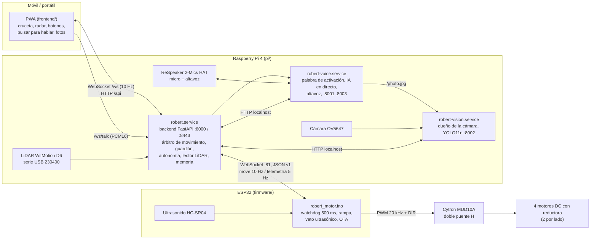
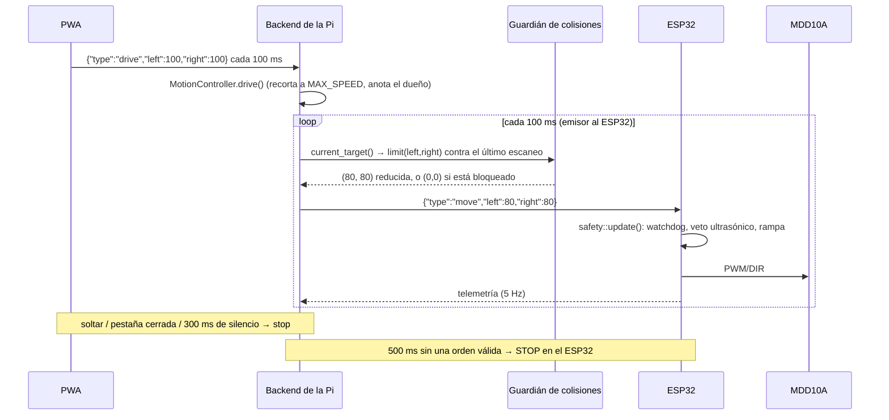
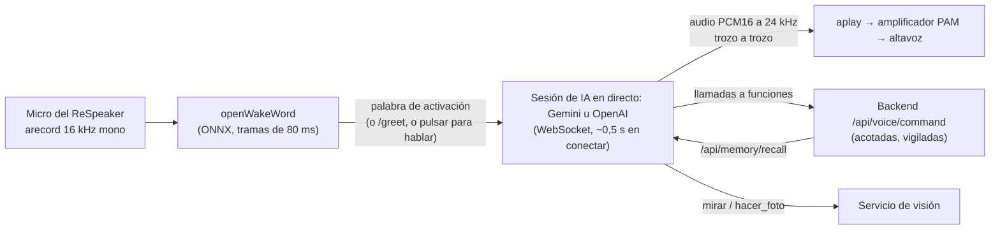

# Robert V2: un rover de cuatro ruedas que te sigue, ve, habla y recuerda

Robert V2 es un rover de tracción diferencial hecho en casa, con una arquitectura de control por
capas: un **ESP32 que controla los motores y la seguridad en tiempo real**, una **Raspberry Pi**
que se encarga de la percepción, la navegación, la voz y un panel de control web, y una
**aplicación web progresiva (PWA)** que hace de mando a distancia desde el móvil. Se puede
conducir a mano, explora una habitación solo con un LiDAR 2D, sigue a una persona combinando la
cámara y el LiDAR, mantiene conversaciones habladas con una IA de voz en directo (Gemini Live u
OpenAI Realtime, a tu elección), hace fotos, saluda a desconocidos y guarda memoria de lo que vive
de una sesión a otra.

Este documento es la guía técnica del proyecto: qué se construye, por qué de esta manera, de qué
depende, cómo funciona cada subsistema y cómo montarlo, calibrarlo, probarlo y ponerlo en marcha.
La guía y todo lo que ve el usuario (la PWA y la voz de Robert) están en español; el código y sus
comentarios, en inglés.

- Predecesor: [Robert V1](https://github.com/FranciscooGarciaa/Robert), montado sobre un kit de
  orugas Freenove cuyo servidor de fábrica no tenía watchdog. V2 sustituye todo eso por hardware y
  software propios, desde el driver de motores hacia arriba. Página del proyecto:
  <https://franslab.es/projects/robert-v2>.
- Estado (2026-10-29): todos los subsistemas de abajo están implementados, probados en casa y en
  la calle. Ver [Estado del proyecto](#estado-del-proyecto-y-limitaciones-conocidas).
- Montaje: el cableado paso a paso está en [`docs/guia-montaje.md`](docs/guia-montaje.md) y las
  piezas para imprimir en [`cad/`](cad/README.md).

## Contenido

1. [Qué estamos construyendo](#qué-estamos-construyendo)
2. [Arquitectura del sistema](#arquitectura-del-sistema)
3. [Hardware](#hardware)
4. [Diseño de seguridad](#diseño-de-seguridad)
5. [Firmware del ESP32](#firmware-del-esp32)
6. [Backend en la Raspberry Pi](#backend-en-la-raspberry-pi)
7. [Percepción](#percepción)
8. [Navegación](#navegación)
9. [Voz](#voz)
10. [Memoria](#memoria)
11. [App web (PWA)](#app-web-pwa)
12. [Dependencias](#dependencias)
13. [Montaje, instalación y despliegue](#montaje-instalación-y-despliegue)
14. [Calibración](#calibración)
15. [Tests](#tests)
16. [Estructura del repositorio](#estructura-del-repositorio)
17. [Estado del proyecto y limitaciones conocidas](#estado-del-proyecto-y-limitaciones-conocidas)
18. [Licencia](#licencia)

---

## Qué estamos construyendo

**Objetivo.** Un robot pequeño que sea seguro de conducir entre personas, que funcione sin mapa
ni encoders en las ruedas y con el que sea agradable interactuar: puedes hablarle, preguntarle qué
ve, pedirle que te siga, y se acuerda de lo que pasó otros días.

**Capacidades.**

| Capacidad | Cómo | Dónde |
|---|---|---|
| Conducción manual desde el móvil | Cruceta de mantener pulsado en la PWA por WebSocket, estilo hombre muerto | `frontend/`, `pi/robert/api/ws.py` |
| Guardián de colisiones en cada orden | El escaneo del LiDAR se barre a lo largo del camino ordenado; la velocidad se reduce y sólo se bloquea la dirección peligrosa | `pi/robert/nav/guard.py` |
| Explorar una habitación solo | Planificador local reactivo sobre un abanico de arcos, elección de objetivo por pasillos con histéresis | `pi/robert/nav/explore.py`, `planner.py`, `autonomy.py` |
| Seguir a una persona | La cámara (YOLO11n) propone una dirección y el seguimiento de clústeres del LiDAR (filtro alfa-beta) la fija y la sigue a 0,6 m | `pi/robert/nav/follow.py`, `pi/robert/vision/` |
| Conversación hablada | Palabra de activación en local y después una sesión en directo con Gemini Live u OpenAI Realtime, con llamadas a funciones | `pi/robert/voice/` |
| Mirar por la cámara y hacerse selfies | Fotos de la cámara enviadas al modelo; fotos a resolución completa servidas por la PWA | `pi/robert/vision/service.py` |
| Modo social | Saluda a quien se para delante 2 s (el LiDAR lo propone, la cámara lo confirma) | `pi/robert/nav/social.py` |
| Bailes y movimientos cortos por voz | Coreografías fijas y acotadas y empujones de 1 s, todo por el mismo camino de movimiento vigilado | `pi/robert/robot/dance.py`, `nudge.py` |
| Memoria entre sesiones | Un diario JSONL por sesión y un resumen que pasa de una a otra, inyectado en el prompt de la voz | `pi/robert/memory.py`, `docs/memoria.md` |
| Compatibilidad con ROS 2 | Nodo puente que publica el LiDAR como `sensor_msgs/LaserScan` | `ros/robert_laser_bridge.py`, `docs/lidar-y-ros.md` |

**Principios de diseño.**

1. **Ante la duda, STOP.** Cada capa trata la pérdida de su entrada como una parada: el watchdog
   del ESP32, el hombre muerto de la Pi, la gestión de soltar el botón de la PWA. Ninguna orden de
   motor se queda puesta.
2. **Un único dueño por recurso.** Sólo el ESP32 toca el driver de motores. Sólo el backend de la
   Pi decide las velocidades objetivo (el "árbitro de movimiento"). Sólo el servicio de visión abre
   la cámara. Sólo el backend abre el puerto serie del LiDAR.
3. **Reactivo, sin mapa.** No hay encoders ni mapa. Todo lo que decide el robot sale de la última
   vuelta del LiDAR, lo que hace que su comportamiento sea fácil de razonar y de probar con
   escaneos grabados.
4. **La voz es un cliente, no un controlador.** El proceso de voz sólo puede pedir al backend
   acciones acotadas (un empujón de 1 s, un baile, seguirte); nunca puede activar la exploración, y
   toda acción sigue pasando por el hombre muerto, el guardián y la capa de seguridad del ESP32.

---

## Arquitectura del sistema



**Tres procesos en la Pi y uno en el ESP32.** El backend es el único proceso de la Pi con tareas
de tiempo real (un bucle de navegación a 10 Hz y un emisor a 10 Hz hacia el ESP32), así que la
latencia del audio y de la red de los servicios de voz y visión nunca puede retrasar una parada.
Los servicios de voz y visión sólo hablan con el backend por HTTP en localhost, y el backend
rechaza esas rutas desde cualquier otra máquina.

**Recorrido de una orden de conducción** (conducción manual):



---

## Hardware

La lista completa de componentes, con cantidades y herramientas, y el esquema eléctrico paso a
paso están en [`docs/guia-montaje.md`](docs/guia-montaje.md).

### Lista de materiales

| Pieza | Función | Notas |
|---|---|---|
| Raspberry Pi 4 (1 GB) | Percepción, navegación, voz, servidor web | Raspberry Pi OS (Debian 13, 64 bits), sin pantalla; arranca a consola para liberar RAM |
| ESP32 (placa de desarrollo WROOM) | Controlador de motores y seguridad en tiempo real | Núcleo Arduino 3.x; mDNS `robert-motor.local`; OTA en el puerto 3232 |
| Cytron MDD10A | Driver doble de motores de 10 A | Dos canales; cada uno mueve en paralelo los dos motores de un lado; PWM hasta 20 kHz |
| 4 × motores DC con reductora + ruedas | Base de tracción diferencial (skid-steer) | Huella de 325 × 160 mm (medida el 2026-10-22) |
| WitMotion D6 (Guoke COIN-D6) | LiDAR 2D de 360° | dTOF, ~10 vueltas/s, ~400 puntos/vuelta, 230400 8N1 por un adaptador USB CH340 |
| HC-SR04 | Distancia frontal por ultrasonido | Veto de obstáculos local en el ESP32; eco por un divisor 1k/2k |
| Módulo de cámara OV5647 | Cámara frontal | Vídeo 640 × 480 a 6 fps, fotos de 2592 × 1944; ~54° de campo horizontal |
| ReSpeaker 2-Mics Pi HAT v2.0 | Micrófonos y salida de audio | Códec TLV320AIC3104; altavoces por un pequeño amplificador PAM de clase D alimentado desde la batería |
| Batería LiPo con conector XT60 | Energía | El XT60 es el corte de emergencia físico; el STOP por software es sólo lógico |
| Hotspot del móvil (2,4 GHz) | Red en la calle | Pi, ESP32 y móvil en la misma red; en casa, una Wi-Fi normal |

### Pines del ESP32 (validados en el banco; no los cambies sin medir)

| GPIO del ESP32 | Conexión |
|---|---|
| 25 | MDD10A PWM1 (M1 = ruedas derechas) |
| 26 | MDD10A DIR1 |
| 27 | MDD10A PWM2 (M2 = ruedas izquierdas) |
| 33 | MDD10A DIR2 |
| 32 | HC-SR04 TRIG |
| 35 | HC-SR04 ECHO **por un divisor 1k/2k** (5 V → 3,3 V; pin sólo de entrada) |

**Referencia del robot.** El frontal del robot es el lado del HC-SR04, así que el veto
ultrasónico vigila la dirección de avance. Visto desde delante, M2 es el lado izquierdo y M1 el
derecho, y "adelante" es DIR LOW en los dos canales (validado el 2026-10-22; la documentación
original describía el robot desde el otro extremo). Todo esto vive en
`firmware/robert_motor/config.h`. La navegación usa la convención ROS REP 103: x hacia delante,
y hacia la izquierda, ángulos en sentido antihorario, metros y radianes. Las celdas del LiDAR se
publican en sentido horario desde el frontal y se convierten en `nav/scan.py`.

### Modelo de movimiento (sin encoders)

Las velocidades son estimaciones en lazo abierto a partir del PWM, calibradas usando el LiDAR
como cinta métrica (`tools/calibrate_motion.py`, 2026-10-24):

| Parámetro | Valor | Significado |
|---|---|---|
| `MPS_PER_PWM` | 0,00475 m/s por unidad de PWM | PWM 100 ≈ 0,48 m/s, PWM 200 ≈ 0,95 m/s |
| `TRACK_EFF_M` | 0,848 m | Ancho de vía efectivo del skid-steer (65°/s girando sobre sí mismo a PWM 100) |
| `PWM_DEADBAND` | 40 | Por debajo de esto las ruedas no giran |
| `ROBOT_MARGIN_M` | 0,10 m | Margen que el guardián mantiene alrededor del cuerpo |

---

## Diseño de seguridad

La seguridad va por capas; cada una funciona aunque desaparezca todo lo que tiene por encima.

| Capa | Dónde | Disparador | Acción |
|---|---|---|---|
| 1. Corte físico | Conector XT60 | Una persona | Motores sin alimentación |
| 2. Arranque del ESP32 | `motors::begin()`, lo primero de `setup()` | Encendido o reinicio | Salidas forzadas a STOP antes incluso de arrancar el Wi-Fi; nada se mueve hasta que un controlador autenticado manda un `move` válido |
| 3. Watchdog del ESP32 | `safety::update()` | 500 ms sin una orden válida mientras se mueve | STOP, enclavado hasta un nuevo `move` |
| 4. Pérdida de enlace en el ESP32 | Callbacks de `net` | Se cierra el socket del controlador, se pierde el Wi-Fi, empieza una OTA, otro controlador toma el mando, JSON mal formado del controlador | STOP, enclavado |
| 5. Veto ultrasónico | `safety::update()` | Obstáculo confirmado a < 15 cm (mediana de 3, histéresis de 5 cm) y la orden tiene componente hacia delante | Avance bloqueado; marcha atrás y giro sobre sí mismo siguen permitidos |
| 6. Hombre muerto en la Pi | `MotionController.current_target()` | 300 ms sin que quien conduce reenvíe su orden | STOP (`deadman`) |
| 7. Guardián de colisiones en la Pi | `CollisionGuard.limit()` | El barrido del LiDAR alcanza la distancia de frenado, o el LiDAR está desactualizado (> 0,35 s) | Velocidad reducida a 0 en la dirección peligrosa; a ciegas: manual limitado a PWM 80, autonomía parada |
| 8. Soltar el mando | `ws.py`, `app.js` | Se cierra el WebSocket, se oculta la pestaña, la ventana pierde el foco, se suelta el botón, mensaje mal formado | STOP desde la Pi; la PWA también para con `visibilitychange`, `blur` y `pagehide` |

Reglas adicionales: la salida a motores tiene la pendiente limitada en el ESP32 (de 0 a 255 en
~170 ms), así que una orden equivocada no puede dar un tirón al robot; la Pi limita toda orden
manual a `MAX_SPEED` (180) y la autonomía a `AUTO_MAX_SPEED` (100); los bailes duran como mucho
6 s y los empujones 1 s; el seguimiento para si pierde a la persona 2 s (+4 s de margen para
recuperarla), si se aleja más de 4,5 m o a los 10 minutos.

**Estados de failsafe** que informa el ESP32 (`safety::Failsafe`): `none`, `boot`, `watchdog`,
`disconnect`, `wifi_lost`, `handover`, `malformed`, `ota`, `obstacle` (este último no se
enclava). Los cambios se envían a la Pi como mensajes `event` y se muestran en la PWA.

**Lista de comprobación en el banco** (ruedas en el aire, desde el ordenador con
`tools/esp32_cli.py`):

1. Arranque: motores quietos, log `[BOOT] ready, motors STOPPED`.
2. `bench`: las cuatro ruedas giran en el sentido correcto para adelante / atrás / izquierda / derecha.
3. `watchdog`: para en menos de 500 ms con `[SAFE] watchdog -> STOP`.
4. Matar el script o el Wi-Fi del ordenador durante `drive`: para.
5. Un objeto a menos de 15 cm: avance bloqueado; marcha atrás y giro sobre sí mismo siguen funcionando.
6. `garbage`: bytes aleatorios nunca mueven nada.
7. Con la Pi: cerrar la pestaña de la PWA mientras conduces → para; `systemctl stop robert` → para por el watchdog del ESP32.

---

## Firmware del ESP32

`firmware/robert_motor/` es un sketch de Arduino dividido en módulos de una sola responsabilidad:

| Módulo | Responsabilidad |
|---|---|
| `robert_motor.ino` | Orden de arranque, reparto de mensajes, telemetría a 5 Hz |
| `config.h` | Todas las constantes: pines, PWM 20 kHz / 8 bits, rampa de 15 unidades cada 10 ms, watchdog de 500 ms, umbrales del ultrasonido, nombre mDNS, puertos |
| `motor_controller.*` | Etapa de salida al MDD10A: velocidades con signo −255..255, rampa, `emergencyStop()` saltándose la rampa; todo lo relativo a la polaridad vive aquí |
| `safety.*` | Decide qué pueden hacer los motores: watchdog, failsafes enclavados, veto ultrasónico, eventos |
| `ultrasonic.*` | HC-SR04 sin bloqueos: disparo cada 60 ms, eco cronometrado por interrupción, mediana de 3, histéresis, contador de timeouts |
| `net.*` | Wi-Fi con varias redes y reconexión, mDNS, servidor WebSocket en el puerto 81, un único controlador autenticado, ArduinoOTA |
| `protocol.*` | Lectura y construcción de JSON con ArduinoJson |
| `secrets.h` | Redes Wi-Fi y el `CONTROL_TOKEN` compartido (fuera de git; copia `secrets.example.h`) |

El bucle principal es cooperativo y nunca se bloquea: `net::update → ultrasonic::update →
safety::update → motors::update`, más la telemetría cada 200 ms.

### Protocolo v1 (JSON por WebSocket, Pi ↔ ESP32)

| Sentido | Mensaje | Notas |
|---|---|---|
| Pi → ESP32 | `{"type":"hello","v":1,"token":"…"}` | Tiene que ser el primero. Versión o token incorrectos → `error` y desconexión. Un segundo controlador válido sustituye al primero (failsafe `handover`). |
| Pi → ESP32 | `{"type":"move","left":-255..255,"right":-255..255}` | Se envía a 10 Hz; hace también de latido y libera los failsafes enclavados |
| Pi → ESP32 | `{"type":"stop"}` | Parada inmediata, sin rampa |
| Pi → ESP32 | `{"type":"heartbeat"}` | Refresca el watchdog sin cambiar la velocidad |
| ESP32 → Pi | `{"type":"hello_ack","reset_reason":"poweron",…}` | Se registra el motivo del reinicio; los inesperados (`brownout`, `panic`, `wdt`) generan un aviso |
| ESP32 → Pi | `{"type":"telemetry",…}` a 5 Hz | Velocidad pedida y real I/D, failsafe, distancia / obstáculo / timeouts del ultrasonido, RSSI del Wi-Fi, tiempo encendido |
| ESP32 → Pi | `{"type":"event","failsafe":"watchdog",…}` | En cada cambio de estado de seguridad |
| ESP32 → Pi | `{"type":"error","error":"bad_token"}` | `bad_version`, `bad_token`, `not_controller`, errores de lectura |

Una entrada mal formada nunca refresca el watchdog; si viene del controlador, dispara el failsafe
`malformed`. Los clientes que no son el controlador sólo pueden recibir errores.

### Compilar y flashear

```sh
cp firmware/robert_motor/secrets.example.h firmware/robert_motor/secrets.h   # Wi-Fi + token
arduino-cli lib install WebSockets ArduinoJson
arduino-cli compile --fqbn esp32:esp32:esp32 firmware/robert_motor
# Flasheo por USB: LiPo DESCONECTADA, sólo USB
arduino-cli upload  --fqbn esp32:esp32:esp32 -p /dev/cu.usbserial-0001 firmware/robert_motor
arduino-cli monitor -p /dev/cu.usbserial-0001 -c baudrate=115200
```

Actualización por Wi-Fi (sin USB; los motores se paran mientras dura, failsafe `ota`):

```sh
arduino-cli compile --fqbn esp32:esp32:esp32 --output-dir build firmware/robert_motor
python3 ~/Library/Arduino15/packages/esp32/hardware/esp32/3.3.12/tools/espota.py \
  -i robert-motor.local -p 3232 -a "$ESP32_TOKEN" -f build/robert_motor.ino.bin
```

---

## Backend en la Raspberry Pi

`pi/robert/` es un paquete de Python; `python -m robert.main` arranca el backend (FastAPI sobre
uvicorn). La configuración sale de variables de entorno con un lector mínimo de `.env`
(`config.py`; cada ajuste está documentado en `pi/.env.example`).

### Estructura del paquete

```
pi/robert/
├── main.py            create_app(): conecta todo, bucle de navegación a 10 Hz, ciclo de vida (stop al apagar)
├── config.py          Settings (ESP32, LiDAR, modelo, guardián, autonomía, seguimiento, memoria, HTTP)
├── memory.py          diario de sesión + resumen que pasa de una sesión a otra (ver Memoria)
├── api/
│   ├── http.py        REST: estado, stop, salud, escaneo del LiDAR, rutas de voz/visión/memoria, fotos
│   └── ws.py          WebSocket de la PWA (/ws) y relé de pulsar para hablar (/ws/talk)
├── robot/
│   ├── state.py       RobotState: el único estado compartido, de sólo lectura para la API
│   ├── motion.py      MotionController: el árbitro de movimiento (hombre muerto, límites, guardián)
│   ├── esp32_client.py  cliente WebSocket del ESP32: hello, emisor a 10 Hz, telemetría, reconexión
│   ├── lidar.py       hilo lector serie del D6 → 360 celdas de un grado
│   ├── nudge.py       movimientos acotados de 1 s pedidos por voz
│   └── dance.py       coreografías fijas (≤ 6 s)
├── nav/
│   ├── model.py       RobotModel: geometría y modelo PWM ↔ velocidad
│   ├── scan.py        última vuelta como puntos en la referencia del robot; automáscara; direcciones ciegas
│   ├── geometry.py    barridos de la huella a lo largo de arcos y giros (numpy)
│   ├── guard.py       CollisionGuard
│   ├── planner.py     ArcPlanner: abanico de arcos, filtro de frenar a tiempo, escape marcha atrás
│   ├── explore.py     Explorer: puntuación de pasillos con histéresis
│   ├── follow.py      Follower: clústeres, emparejado con la cámara, seguimiento alfa-beta
│   ├── social.py      SocialGreeter
│   ├── calib.py       carga y aplicación de la automáscara del LiDAR
│   └── autonomy.py    Autonomy: modos explorar (armado por latido) y seguir, al ritmo del escaneo
├── vision/            camera.py (vídeo YUV420 de rpicam-vid), detector.py (YOLO11n ONNX), service.py
├── voice/             audio.py (E/S ALSA), listener.py (openWakeWord + webrtcvad), live.py (conversación,
│                      prompt y herramientas), providers/ (Gemini, OpenAI), service.py (proceso),
│                      backend.py (cliente localhost), sfx.py, assets.py
└── sim/fake_esp32.py  simulador del ESP32 con la misma semántica de seguridad (tests y pruebas sin hardware)
```

### Procesos y puertos

| Unidad systemd | Punto de entrada | Puertos | Para qué |
|---|---|---|---|
| `robert` | `robert.main` | 8000 HTTP, 8443 HTTPS (la misma app) | Backend y PWA |
| `robert-voice` | `robert.voice.service` | 8001 (`POST /greet`), 8003 (PCM crudo desde la PWA) | Palabra de activación, conversación, altavoz |
| `robert-vision` | `robert.vision.service` | 8002 (`/photo.jpg`, `/people_now`, `/photo/full`, `/detect/on` y `/detect/off`) | Dueño de la cámara y detección de personas |

Los tres corren con el usuario normal y `Restart=always`. Matar un proceso lo reinicia con el
código nuevo, que es como `deploy.sh` reinicia sin sudo.

### El árbitro de movimiento

`MotionController` es el único objeto que fija las velocidades objetivo que se envían al ESP32.
Toda orden, manual o autónoma, es de tipo hombre muerto: quien conduce tiene que seguir
reenviándola o el objetivo vuelve a cero a los 300 ms. En cada envío a 10 Hz, `current_target()`
comprueba el hombre muerto y después pasa el objetivo al guardián, que puede reducirlo o ponerlo a
cero; lo que devuelve el guardián es lo que recibe el ESP32 (y lo que la PWA muestra como "salida
I/D"). Cada parada lleva un motivo (`deadman`, `pwa-3_stop`, `follow_lost`, `voice_stop`,
`shutdown`…) que acaba en el estado, en los logs, en la PWA y en la memoria.

### API HTTP y WebSocket

| Ruta | Descripción |
|---|---|
| `GET /api/state` | `RobotState.snapshot()` completo: telemetría del ESP32, ultrasonido, movimiento, estadísticas del LiDAR, navegación (estado del guardián, espacio libre, camino, seguimiento, social), visión, voz, tiempo encendido |
| `POST /api/stop` | Parada lógica |
| `GET /api/health` | `{ok, esp32_connected}` |
| `GET /api/lidar/scan` | Última vuelta: 360 celdas en mm (0 = sin eco) |
| `GET /api/photos`, `GET /api/photos/{name}` | Selfies hechos por el servicio de visión |
| `GET /api/memory`, `/api/memory/session`, `/api/memory/recall` | Resumen de la memoria, diario actual, texto para el prompt |
| `POST /api/voice/event`, `/api/voice/command`, `/api/vision/people`, `/api/memory/note`, `/api/memory/story`, `/api/memory/event` | **Sólo localhost**: las usan los servicios de voz y visión |
| `WS /ws` | Control desde la PWA: `drive`, `stop`, `auto` (explorar, rearmado cada 100 ms), `follow`, `social`; la Pi envía `state` a 10 Hz y `scan` a 5 Hz |
| `WS /ws/talk` | Pulsar para hablar: tramas binarias PCM16 mono a 16 kHz que se pasan al servicio de voz |

---

## Percepción

### LiDAR (WitMotion D6)

El sensor emite datos en cuanto recibe corriente. `robot/lidar.py` implementa la cadena clásica de
un sensor serie: tramas por la cabecera `AA 55`, longitud a partir de `LSN`, checksum XOR con
resincronización, decodificación little-endian (`angle = (raw >> 1) / 64` grados,
`distance_mm = (b2 << 6) | (b1 >> 2)`), interpolación lineal de los ángulos entre FSA y LSA, y
agrupación en vueltas con el paquete de inicio de vuelta. Un hilo lector publica cada vuelta como
360 celdas de un grado en la referencia del robot (el eco más cercano de cada celda), tras aplicar
el desfase de montaje medido (`LIDAR_OFFSET_DEG=272`) y el sentido de giro.

Partes del robot quedan dentro del campo de visión del LiDAR. `tools/calibrate_lidar.py` registra
esas celdas como una **automáscara** (`pi/lidar_mask.json`); los ecos enmascarados se descartan y
el planificador nunca conduce hacia una dirección que no puede ver (a mano sí se puede, despacio).
El LiDAR sólo ve en su plano: bordillos, escalones hacia abajo y objetos bajos quedan para el
ultrasonido.

Una explicación detallada y didáctica del sensor, del formato de los datos y del puente con ROS 2
(imagen Docker `ros:jazzy-ros-base`, `/scan` como `sensor_msgs/LaserScan`) está en
[`docs/lidar-y-ros.md`](docs/lidar-y-ros.md).

### Ultrasonido (HC-SR04)

Se lee en el ESP32 cada 60 ms, con el eco cronometrado por interrupción; hay obstáculo por debajo
de 15 cm y se libera por encima de 20 cm; las lecturas se limitan a 2–400 cm y un eco que no llega
cuenta como "libre" (el contador `us_timeouts` de la telemetría deja ver si el sensor se ha
desconectado).

### Cámara y detección de personas

`vision/service.py` es el único dueño de la cámara. Mantiene un vídeo YUV420 continuo de
640 × 480 a 6 fps desde `rpicam-vid`, para que una foto para la voz sea instantánea, y ejecuta
**YOLO11n** (ONNX, 320 × 320 con letterbox, `onnxruntime` en la CPU, ~170 ms por imagen en la
Pi 4) sólo cuando el backend lo pide: durante el seguimiento y para la comprobación puntual del
modo social. Las detecciones se dan como direcciones en la referencia del robot
(`bearing_deg = −(cx/w − 0.5) · HFOV`, con un campo horizontal de 54°), que es todo lo que necesita
la navegación. Las fotos a resolución completa (2592 × 1944) se hacen con `rpicam-still`,
pausando el vídeo ~1,5 s.

---

## Navegación

Toda la navegación corre en el `nav_loop` del backend al ritmo del escaneo (10 Hz,
`TICK_S = 0.1`) y cuesta ~7 ms por ciclo en la Pi 4. En cada ciclo: actualiza el espacio libre
para la PWA y la voz, ejecuta un paso de autonomía, actualiza el modo social y deja que la memoria
observe los cambios de estado.

### Guardián de colisiones (`nav/guard.py`)

El `(left, right)` ordenado se convierte en `(v, ω)` con el modelo de movimiento y en un camino: un
arco de curvatura `ω/v`, o un giro sobre sí mismo si el radio es menor de 0,10 m. La huella del
robot más el margen se barre a lo largo de ese camino contra los puntos del escaneo
(`geometry.py`). El recorrido libre se compara con la **distancia de frenado**
`v · latencia + v² / (2 · decel)` (latencia de 0,25 s, deceleración de 1 m/s²): el factor de
velocidad baja linealmente de 1 a `frenado + 0,40 m` hasta 0 a `frenado`. Sólo se rechaza la orden
peligrosa: dar marcha atrás o girar para alejarse siempre es posible. Sin un escaneo de menos de
0,35 s el guardián está "a ciegas": la conducción manual se limita a PWM 80 (el veto del ESP32
sigue activo) y la autonomía se para.

### Explorar (`nav/explore.py`, `nav/planner.py`, `nav/autonomy.py`)

La exploración sólo funciona mientras el operador la mantiene armada (la PWA reenvía `auto` cada
100 ms, como un hombre muerto). En cada ciclo, el **Explorer** mide, en 36 direcciones, hasta dónde
llega un pasillo del ancho del robot antes de chocar con algo (con un máximo de 3 m), y puntúa los
pasillos por longitud, por girar poco (0,6 m de pasillo por π rad) y con un extra por mantenerse
cerca de la elección anterior (histéresis de ±25°), arrastrando la dirección anterior al restarle
la rotación ordenada, porque no hay odometría. Después el **ArcPlanner** barre 13 curvaturas × 2
velocidades más dos giros sobre sí mismo en un horizonte de 2 m, descarta los arcos en los que no
podría frenar a tiempo y elige el mejor equilibrio entre rumbo al objetivo, espacio libre,
velocidad y suavidad. Cuando no cabe nada hacia delante y el giro está bloqueado o dura ya 2,5 s,
sale marcha atrás por el más libre de cinco arcos y lo mantiene ~0,8 s. Cualquier STOP,
conducción manual, LiDAR a ciegas o quedarse atascado (> 8 s sin avanzar) la desarma.

### Sígueme (`nav/follow.py`)

Para engancharse a alguien tienen que coincidir los dos sensores: un clúster del LiDAR del ancho de
una persona (0,03–0,8 m: una pierna a 3 m son sólo 2–3 puntos) a menos de 3 m y ±25° del frontal,
en la misma dirección que una detección de la cámara (±6° de margen), durante un máximo de 3 s. A
partir de ahí el LiDAR sigue el clúster por sí solo a 10 Hz con un filtro alfa-beta (α 0,6, β 0,2)
y una asociación con ventana (0,5 m, 0,7 m para recuperarlo), así que la persona puede salirse del
estrecho campo de la cámara. El controlador mantiene 0,6 m desde el centro del robot (se queda
quieto por debajo de 0,5 m), acelera 1,2 m/s por cada metro de distancia de más hasta PWM 200
(~0,95 m/s, paso ligero), gira sobre sí mismo cuando la persona está a más de 35° y, si no, planifica
un arco con el mismo planificador y guardián que Explorar. La persona seguida es el hombre muerto:
perderla 2 s (más 4 s para recuperarla cerca de su última posición), 4,5 m de distancia o 10
minutos lo terminan, con un motivo de parada que la PWA y la voz pueden explicar.

### Modo social, empujones y bailes

**Modo social** (`nav/social.py`): con el robot parado, un clúster del tamaño de una persona a
menos de 1,2 m y ±30° delante durante 2 s dispara una comprobación con la cámara; si la cámara lo
confirma, se pide al servicio de voz que abra una conversación con un saludo. Espera de 60 s entre
saludos, y nunca mientras se mueve o habla. Los **empujones** (`robot/nudge.py`) son el "avanza /
gira a la izquierda" de la voz: una orden de conducción reenviada a 10 Hz durante 1 s como mucho.
Los **bailes** (`robot/dance.py`) son listas fijas de pasos (`baile`, `vuelta`, `celebracion`,
≤ 6 s, giros a PWM 150 usando los 65°/s calibrados por cada PWM 100). Todos pasan por
`MotionController`, así que el hombre muerto, el guardián y el ESP32 siguen actuando, y cualquier
parada o conducción manual los cancela.

---

## Voz

El servicio de voz es un proceso aparte para que el audio nunca toque el control de los motores.
La cadena, medida en la Pi (2026-10-23):



- **Palabra de activación**: openWakeWord sobre `onnxruntime` (por defecto el modelo incluido
  `hey_jarvis`; `WAKE_MODEL` puede apuntar a un `.onnx` propio). Es lo único que corre todo el
  tiempo.
- **Proveedor**: `AI_PROVIDER` + `AI_API_KEY` en `pi/.env` eligen la IA. `gemini` (Gemini Live,
  `gemini-3.8-live`, voz `Puck`; la que se ha medido abajo) u `openai` (OpenAI Realtime, el modelo
  que hay detrás de la voz de ChatGPT: `gpt-realtime`, voz `marin`). Cada uno es un adaptador en
  `voice/providers/` que traduce su sesión en directo a la misma interfaz pequeña (enviar audio,
  recibir audio/transcripciones/llamadas a funciones, responder a las llamadas); añadir otro
  proveedor consiste en escribir otro adaptador. El adaptador de OpenAI está cubierto por tests
  contra un socket simulado, pero todavía no se ha probado en el robot.
- **Conversación**: una sesión en directo transmite el micrófono; el VAD del servidor cierra cada
  turno (600 ms de silencio, sensibilidad baja de fin de frase, elegida después de que 300 ms
  cortaran a la gente en su primera pausa). Las respuestas llegan como audio a 24 kHz y se
  reproducen según llegan: de 0,6 a 0,8 s desde que terminas de hablar hasta el primer sonido.
- **Semidúplex**: el ReSpeaker no tiene cancelación de eco, así que el micrófono se silencia
  mientras Robert habla y se reabre 150 ms después de terminar. Un webrtcvad local marca cuándo
  se habla para el tiempo de inactividad de 10 s.
- **Herramientas** (llamadas a funciones; la personalidad de Robert y la descripción de las
  herramientas están en `SYSTEM_PROMPT`, `voice/live.py`):

| Herramienta | Qué hace |
|---|---|
| `parar` | Para inmediatamente |
| `mover(direccion)` | Empujón de 1 s adelante / atrás / izquierda / derecha |
| `mirar` | Foto de la cámara frontal adjunta a la respuesta, para que el modelo describa lo que ve |
| `estado_robot` | Espacio libre alrededor (del guardián, nunca del LiDAR en crudo) y si se está moviendo |
| `seguirme`, `dejar_de_seguir` | Empieza a seguir (espera hasta 3 s para decir si ha encontrado a alguien) / para |
| `bailar(estilo)` | Uno de los tres bailes |
| `hacer_foto` | Pitidos de cuenta atrás, selfie a resolución completa, sonido de obturador; la foto aparece en la PWA |
| `modo_social(activar)` | Activa o desactiva el modo social |
| `recordar`, `apuntar(nota)` | Lee la memoria / guarda una nota que le han pedido recordar |
| `despedirse` | Termina la conversación |

- **Otras formas de empezar**: `POST 127.0.0.1:8001/greet` (modo social) abre una conversación en
  la que Robert habla primero; el botón de pulsar para hablar de la PWA envía el micrófono del
  móvil al puerto 8003 y sustituye al micro del robot durante esa conversación. iOS sólo deja usar
  el micrófono en una página segura, así que la PWA también se sirve por HTTPS en el puerto 8443
  con una CA propia (`tools/make_certs.sh`; el certificado de la CA se instala y se marca como de
  confianza en el móvil una sola vez).
- **Niveles de audio** (validados el 2026-10-23/24, guardados con `alsactl`): micro a +27 dB con el
  filtro paso alto, lo que permite hablarle desde 2–3 m; salida a 0 dB. PipeWire está enmascarado
  porque WirePlumber reiniciaba el volumen en cada arranque.

---

## Memoria

Robert guarda en JSON plano una memoria de lo que vive (`pi/robert/memory.py`, descripción
completa en [`docs/memoria.md`](docs/memoria.md)):

- **Diario por sesión** (`~/robert-memory/sessions/<id>.jsonl`): un evento por línea. El backend
  anota lo que le cuentan (turnos de voz con lo que oyó y dijo, órdenes habladas, fotos, notas,
  saludos) y, observando `RobotState` en cada ciclo, los cambios que merece la pena recordar: ESP32
  perdido o recuperado, paradas de seguridad, empezar a seguir a alguien y por qué terminó,
  exploraciones, atascos, bailes, inicio y duración de las conversaciones.
- **Resumen** (`memory.json`): totales, las últimas 30 sesiones, **vivencias** contadas por el
  propio Robert (las primeras se siembran desde `pi/memory_seed.json`; en el repositorio hay un
  ejemplo, `pi/memory_seed.example.json`), notas que le han pedido guardar y sus conversaciones
  recientes.
- **Recuerdo**: al empezar cada conversación, la voz pide unas pocas líneas en español y las añade
  al prompt, así Robert sabe cuántas veces lo han encendido, qué pasó en la última sesión, sus
  vivencias y sus notas. También se le puede preguntar (`recordar`) y pedirle que guarde cosas
  (`apuntar`).

Escribir nunca falla: con la SD en sólo lectura, la memoria vive en RAM como las fotos, y
`pi/scripts/pull_memory.sh` la copia entre la Pi y el ordenador.

---

## App web (PWA)

`frontend/` es una app HTML/JS/CSS sin dependencias que sirve el propio backend. Muestra el estado
de los enlaces (Pi, ESP32, LiDAR), la distancia del ultrasonido, el modo de movimiento y la salida
ya vigilada, el failsafe actual, un **radar** del LiDAR con el camino previsto por el guardián y el
espacio libre, el estado del seguimiento, el de la voz con lo último que oyó y dijo, y la galería
de fotos. Controles: cruceta de mantener pulsado (ratón, táctil y teclado), regulador de velocidad
(40–180), un STOP grande, Explorar (armado sólo mientras el botón está activo y reenviado cada
100 ms), Sígueme, Modo social y pulsar para hablar. Las órdenes de conducción se envían cada
100 ms; soltar, ocultar la pestaña, cambiar de ventana o cerrar la página manda un stop.

---

## Dependencias

### Raspberry Pi (Python 3.13, `pi/requirements*.txt`)

| Paquete | Para qué |
|---|---|
| `fastapi`, `uvicorn`, `websockets` | API HTTP/WebSocket, servir la PWA, cliente del ESP32 |
| `pyserial` | Puerto serie del LiDAR |
| `numpy` | Procesado del escaneo, barridos de la huella, planificadores, conversión de imágenes |
| `google-genai` | Sesión de Gemini Live (voz, `AI_PROVIDER=gemini`) |
| `websockets` | También la sesión de OpenAI Realtime (voz, `AI_PROVIDER=openai`), sin SDK extra |
| `openwakeword` (instalado con `--no-deps`) + `onnxruntime`, `scikit-learn`, `scipy`, `tqdm`, `requests` | Palabra de activación en la CPU de la Pi (openwakeword exige `tflite-runtime`, que no tiene wheel para Python 3.13 en aarch64, así que corre sobre `onnxruntime`) |
| `webrtcvad-wheels` | Detección de voz local |
| `piper-tts` | Frases en español sin conexión (por ejemplo "no tengo conexión") con la voz `es_ES-davefx-medium` |
| `pillow` | Codificación JPEG de las imágenes de la cámara |
| `pytest`, `httpx` | Tests |

En el sistema: Raspberry Pi OS Lite de 64 bits (Debian 13), `rpicam-apps` (`rpicam-vid`,
`rpicam-still`), ALSA (`arecord`/`aplay`), el overlay del ReSpeaker v2 compilado desde
`seeed-linux-dtoverlays`, el overlay `ov5647`, NetworkManager (`nmcli`) para el perfil del hotspot
y las unidades systemd de `pi/deploy/`. Modelos en la Pi: `~/robert-models/vision/yolo11n-320.onnx`
(exportado en el ordenador con `yolo export model=yolo11n.pt format=onnx imgsz=320`),
`~/robert-models/piper/es_ES-davefx-medium.onnx` y los modelos de openWakeWord.

### ESP32

Núcleo Arduino para ESP32 3.x (`esp32:esp32:esp32`), librerías **WebSockets** (Links2004) y
**ArduinoJson**, `arduino-cli` para compilar y `espota.py` para la OTA.

### Ordenador de desarrollo (macOS)

`arduino-cli`, Python 3 para las herramientas de `tools/`, `rsync`/`ssh` para desplegar y,
opcionalmente, Docker para ROS 2 y `ultralytics` para exportar el modelo YOLO.

### Nube

Un único servicio externo: la **IA de la voz**, Gemini u OpenAI, con tu propia clave
(`AI_PROVIDER`, `AI_API_KEY` en `pi/.env`; un `GEMINI_API_KEY` antiguo sigue funcionando). Todo lo
demás (palabra de activación, VAD, detección, navegación, memoria) corre en el robot. Sin red, el
robot se conduce, explora y sigue con normalidad; la voz responde con una frase local de Piper.

---

## Montaje, instalación y despliegue

### Construye el tuyo

Las piezas para imprimir están en [`cad/`](cad/README.md): un proyecto de Bambu Studio con las 16
placas preparadas para una A1 mini, en PLA. El cableado paso a paso, con la alimentación, los
pines y el failsafe, está en [`docs/guia-montaje.md`](docs/guia-montaje.md). Todo lo personal va en
ficheros fuera de git que creas a partir de un ejemplo:

| Fichero | Se copia de | Qué pones en él |
|---|---|---|
| `firmware/robert_motor/secrets.h` | `secrets.example.h` | Tus redes Wi-Fi y un `CONTROL_TOKEN` que te inventes |
| `pi/.env` | `pi/.env.example` | `ESP32_TOKEN` (= ese token), **tu clave de IA** (`AI_PROVIDER`, `AI_API_KEY`), tu nombre (`OWNER_NAME`) y la calibración de tu robot |
| `pi/scripts/local.env` | `local.env.example` | Opcional: el `PI=<usuario>@<host>` de tu Raspberry, para no escribirlo cada vez en los scripts |
| `pi/memory_seed.json` | `memory_seed.example.json` | Opcional: las vivencias con las que arranca tu robot |
| `pi/certs/` | `tools/make_certs.sh` | Opcional: HTTPS local para el pulsar para hablar de la PWA |

La clave de IA: las de Gemini se sacan en <https://aistudio.google.com/apikey> y las de OpenAI en
<https://platform.openai.com/api-keys> (una suscripción a ChatGPT Plus no es una clave de API). Las
dos se pagan por uso: Robert lo dice en voz alta cuando se acaba el saldo. Los valores de
calibración de `.env.example` son los nuestros; mide tu robot con las herramientas de
[Calibración](#calibración).

### 1. Backend en un portátil, sin hardware

```sh
cd pi && python3 -m venv .venv && .venv/bin/pip install -r requirements-dev.txt
cp .env.example .env                       # ESP32_TOKEN tiene que ser igual a CONTROL_TOKEN de secrets.h
.venv/bin/python -m pytest                 # 103 tests, simulador del ESP32 incluido
.venv/bin/python -m robert.sim.fake_esp32 --port 8181 --token dev &
ESP32_HOST=127.0.0.1 ESP32_PORT=8181 ESP32_TOKEN=dev LIDAR_ENABLED=false .venv/bin/python -m robert.main
# PWA en http://localhost:8000
```

### 2. Raspberry Pi desde cero

Graba Raspberry Pi OS Lite (64 bits) con Raspberry Pi Imager (usuario, Wi-Fi y clave SSH) y,
después, desde tu ordenador:

```sh
PI=<usuario>@<ip> SSH_OPTS="-o HostKeyAlias=robert.local" pi/scripts/setup_pi.sh   # código, overlays de arranque, venv, modelos, servicios
# reinicia la Pi y después:
pi/scripts/setup_pi.sh audio      # niveles del ReSpeaker, enmascarar PipeWire
pi/scripts/setup_pi.sh protect    # SD en sólo lectura (un corte de luz ya no puede corromperla); reinicia
```

`setup_pi.sh` se puede repetir sin problema: sincroniza el código y el `.env`, compila e instala
el overlay del ReSpeaker, activa la cámara, pasa el journal a RAM, crea el venv, descarga los
modelos de Piper y de la palabra de activación, copia el modelo YOLO si defines `YOLO_ONNX`,
instala las tres unidades systemd y deja la Pi arrancando a consola.

### 3. Despliegue del día a día

```sh
pi/scripts/deploy.sh              # rsync de pi/ frontend/ ros/ + pip + reinicio (sin sudo)
ssh <usuario>@robert.local journalctl -u robert -u robert-voice -u robert-vision -f
```

Con la SD protegida, para cambiar algo hace falta `setup_pi.sh unprotect`, reiniciar, desplegar,
`protect` y reiniciar.

### 4. Modo calle

`HOTSPOT="<tu hotspot>" pi/scripts/street_ready.sh` actualiza el ESP32 por Wi-Fi, despliega,
añade el hotspot de tu móvil (2,4 GHz; en iPhone, "Maximizar compatibilidad") como perfil de
NetworkManager en la Pi y vuelve a proteger la SD. En casa el hotspot se queda apagado para que la
Pi y el ESP32 no acaben en redes distintas.

---

## Calibración

| Qué | Herramienta | Resultado |
|---|---|---|
| Automáscara del LiDAR, frontal y sentido de giro | `tools/calibrate_lidar.py` (guiado; primero la máscara, después la orientación) | `pi/lidar_mask.json`, `LIDAR_OFFSET_DEG`, `LIDAR_CLOCKWISE` |
| Alineación del frontal entre ultrasonido y LiDAR | `tools/calibrate_motion.py offset` | Confirma que 0° es justo delante |
| Velocidad por PWM | `tools/calibrate_motion.py forward --pwm 100` (pared a ≥ 2 m delante, el LiDAR como cinta métrica) | `MPS_PER_PWM` |
| Ancho de vía efectivo | `tools/calibrate_motion.py spin --pwm 100 --mps-per-pwm <v>` | `TRACK_EFF_M` |
| Escaneos de una habitación real para los tests | `tools/record_scans.py` | `pi/tests/data/room.jsonl` |
| Pruebas del ESP32 en el banco sin la Pi | `tools/esp32_cli.py` con `monitor`, `bench`, `watchdog`, `garbage` o `drive` | — |

La calibración se hace con el robot en el suelo, en un espacio despejado y con una mano cerca del
XT60.

---

## Tests

`pi/tests/` (pytest, 103 tests, ~13 s) cubre cada capa sin hardware:

| Fichero | Qué comprueba |
|---|---|
| `test_integration.py` | Backend real contra el simulador `fake_esp32`: saludo, rechazo del token, emisor a 10 Hz, stop al desconectar |
| `test_api.py`, `test_voice_api.py` | Conducir/soltar/mensaje mal formado por WebSocket → stop; stop/estado por HTTP; rutas sólo para localhost; empujones acotados |
| `test_motion.py` | Límites, hombre muerto, que sólo suelte quien conduce, avisos de parada |
| `test_lidar.py` | Tramas, checksum, decodificación y celdas con bytes capturados del sensor |
| `test_nav.py`, `test_follow.py` | Guardián sobre una habitación grabada (`data/room.jsonl`), comportamiento del explorador y del planificador, enganche/seguimiento/pérdida en el sígueme (`navsim.py` es un pequeño simulador cinemático) |
| `test_vision.py` | Letterbox, NMS, cálculo de direcciones |
| `test_voice_live.py` | La conversación a través del adaptador de Gemini con sesión/micro/reproductor simulados: streaming, silencio del micro, herramientas, fotos, herramientas de memoria, prompt |
| `test_voice_providers.py` | Adaptador de OpenAI Realtime contra un socket simulado (configuración de la sesión, remuestreo a 24 kHz, audio, herramientas, foto, errores), elección de proveedor y ajustes |
| `test_social_dance_photos.py` | Reglas del saludo social, límites y cancelación de los bailes, listado de fotos |
| `test_memory.py` | Diario y resumen entre arranques, cambios observados, semilla, poda, carpeta sin permisos de escritura, API |

`tests/conftest.py` da a cada test su propia carpeta de memoria. El simulador del ESP32 reproduce
la semántica de seguridad del firmware (saludo con token, un único controlador, watchdog, veto por
obstáculo), así que el backend se puede ejecutar de principio a fin en un portátil.

---

## Estructura del repositorio

```
firmware/robert_motor/   sketch del ESP32 (ver "Firmware del ESP32")
pi/                      lado de la Raspberry Pi: paquete robert/, tests/, deploy/ (systemd), scripts/, .env.example
frontend/                PWA (index.html, app.js, style.css, manifest, icono)
ros/                     puente LaserScan para ROS 2
tools/                   herramientas de calibración, banco y grabación que se ejecutan desde el ordenador
docs/guia-montaje.md     guía de montaje eléctrico: componentes, alimentación, pines, audio, LiDAR, failsafe
docs/lidar-y-ros.md      fundamentos del LiDAR y práctica con ROS 2
docs/memoria.md          formato y API de la memoria
cad/                     piezas para imprimir: proyecto de Bambu Studio, 16 placas
```

Fuera de git a propósito: `firmware/robert_motor/secrets.h`, `pi/.env`, `pi/scripts/local.env`,
`pi/memory_seed.json`, `pi/certs/`, `pi/memory/`.

---

## Estado del proyecto y limitaciones conocidas

**Cronología.** Hito 1 (2026-10-22): firmware, backend, PWA, radar del LiDAR, guardián de
colisiones y Explorar, puente con ROS. 2026-10-23: voz con Gemini Live. 2026-10-24: script de
instalación de la Pi, automáscara del LiDAR y calibración del movimiento, cámara para la voz,
sígueme, SD en sólo lectura. 2026-10-25: primer día en la calle (seguimiento más rápido, bailes,
selfies, saludos sociales, hotspot, pulsar para hablar). 2026-10-28: memoria entre sesiones.
2026-10-29: la IA de la voz se puede elegir (Gemini u OpenAI), todos los valores personales pasan
a ficheros fuera de git, y se publican las piezas 3D y la guía de montaje.

**Limitaciones conocidas y decisiones abiertas.**

- Sin encoders ni mapa: las velocidades son estimaciones en lazo abierto; Explorar y Sígueme son
  puramente reactivos.
- El LiDAR sólo ve en su plano: bordillos y escalones le son invisibles, y el HC-SR04 apunta hacia
  delante en horizontal, así que en la calle sólo sirve para aceras llanas. Está previsto inclinar
  el ultrasonido hacia el suelo.
- Un eco del ultrasonido que no llega se trata como "libre" (también si el sensor está
  desconectado); el contador `us_timeouts` lo deja ver, pero no para el robot.
- La PWA por HTTP no se puede instalar como app en el móvil; funciona como página, y la versión
  HTTPS necesita instalar la CA local una vez.
- Con la SD protegida, los selfies y la memoria viven en RAM; hay que copiarlos antes de apagar.
- La voz depende de la red (el proveedor de IA); sin conexión, Robert sólo dice que no tiene red.
- Aún falta documentar en el repositorio el pinout interno del LiDAR (depende del adaptador
  USB-UART) y fotos del montaje.

---

## Licencia

[PolyForm Noncommercial 1.0.0](LICENSE.md): puedes usar, estudiar, modificar y compartir este
proyecto y construir tu propio rover con él para cualquier fin **no comercial** (proyectos
personales, hobby, educación, investigación). No se permite ganar dinero con él (vender robots,
kits o un producto o servicio basado en este código). Para un uso comercial, pide al autor una
licencia aparte. Las piezas para imprimir de `cad/` están bajo [CC BY-NC 4.0](cad/LICENSE.md),
también no comercial. Las librerías y modelos de terceros que instala mantienen sus propias
licencias.
